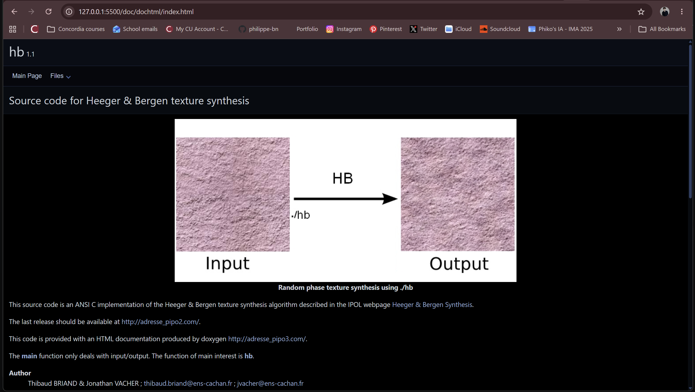
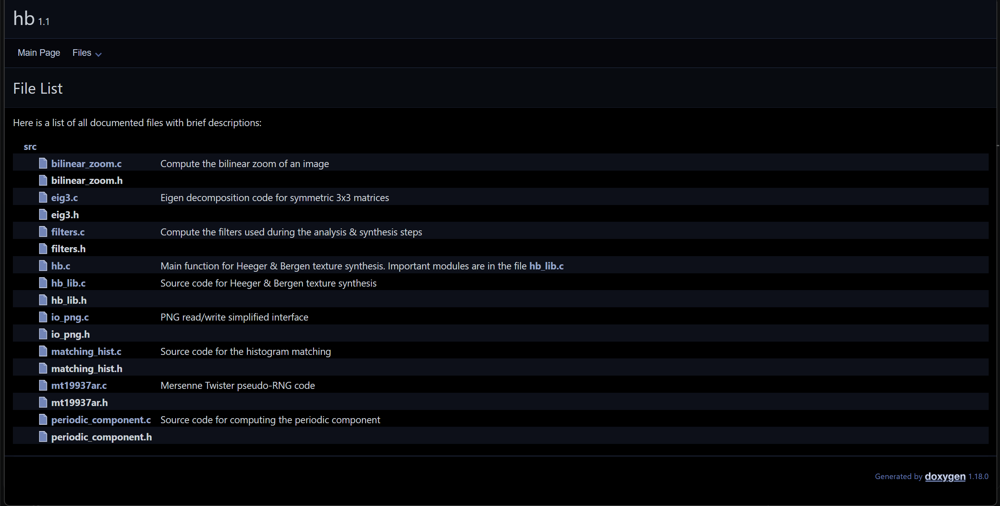

**30/09/26**
I presented the proposal for my project.

**06/10/26**
*RESEARCH & DEVELOPMENT*
This week, I started with research about the various algorithms for texture generation. 
- I read the *Textures* text here ("https://visionbook.mit.edu/textures.html"). 
- I identified the Heeger-Bergen Texture Synthesis algorithm as one I would want to work with and dive deeper into.
- I found this Github repo with an implementation in C# of the algorithm: https://github.com/tbriand/hb_texture_synthesis
For the next steps: 
- I want to check if using this repo would be pertinent.
- I can run basic tests with the algorithm, identifying what each stage of the process affects in the final outcome and where there is space for input data / iteration / bias.
*PHYSICAL COMPUTING*
I also met with someone on Facebook Marketplace who sold me a thermal receipt printer (BTP-R880NP) for 70$.
- It turns on when plugged in and had a paper roll inside of it already.
- It is able to feed paper.
- It requires a USB cable which I would need to find (USB to USB), and I don't know if this will be enough to set up the connection.
- I will need to ask Emile if he can help me "jailbreak" it, like he did with his.

**07/10/26**
 Succeeded at running HTML documentation of repo.
 The repo indicates what each file accomplishes.

**10/10/26**
*RESEARCH & DEVELOPMENT*
I met with Sabine on Saturday October 10th in the Computation Lab to discuss my project.
- I installed an ANSI C compiler.
- I installed Chocolatey.
- I installed the programs needed to run the C code.
- I ran out of time... But Sabine found on the MIT *Textures* text I was a reading a CoLab implementation in Python. I will be using this instead. (https://colab.research.google.com/drive/1y-l8SEa-ALraDgbai5WavAYTDjKbg1AI?usp=sharing)

**14/10/26**
*READING WEEK*
I worked on my project with Sabine early on in reading week so I figured I would keep experimenting when I returned.

**21/10/26**
*RESEARCH & DEVELOPMENT*
I implemented the Python implementation of the Heeber Bergen Texture Analysis Synthesis algorithm.
- I implemented a way to save the generated texture using matplotlib's imgsave function: I read about this at https://www.scaler.com/topics/matplotlib/save-a-plot-in-matplotlib/
- I tried to implement a feedback process where the generated texture image reenters the algorithm: it wasn't working because the image was RGBA instead of RGB, so I read about matplotlib and skimage (https://www.geeksforgeeks.org/python/reading-images-in-python/, https://scikit-image.org/docs/stable/user_guide/transforming_image_data.html), and added an import for rgba2rgb from skimage

**28/10/26**
*IDEATION*
This week, I presented my topic (Queer Algorithmic Aesthetics and Digital Countercultures) as part of the week on *Algorithmic Aesthetics and Visual Design / Cultural Criticism of Digital Media / Cultural Impacts of Generative AI / History of Digital Culture*. Because these topics particularly interest me, I participated in class discussions about the politics of aesthetics. I will use these ideas in my project - paying attention particularly to the political ideas behind the aesthetics I use.

**04/11/26**
I presented my research and work in progress.
